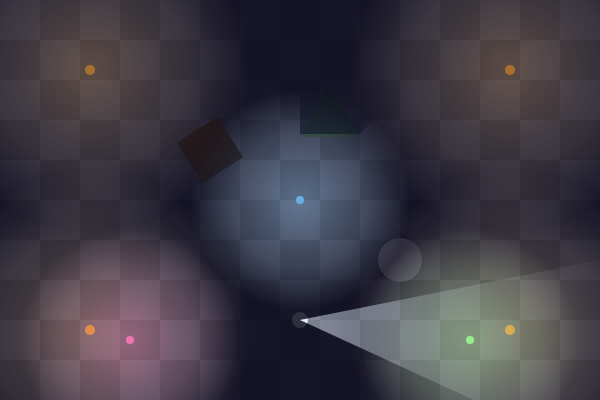
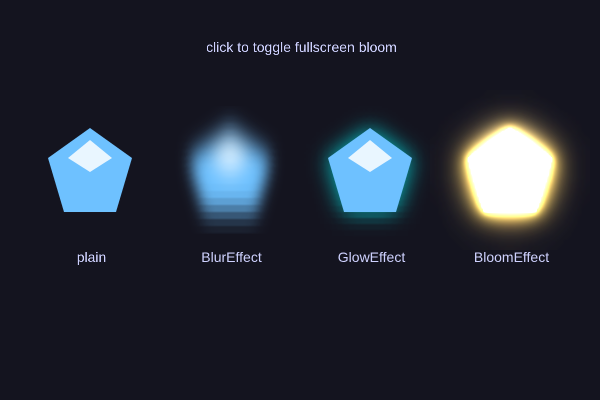
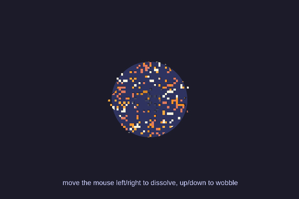

import LightingSample from '!!raw-loader!./samples/lighting.ts';
import ShaderEffectsSample from '!!raw-loader!./samples/shader-effects.ts';
import GlslPipelineSample from '!!raw-loader!./samples/glsl-pipeline.ts';
import SoundMixerSample from '!!raw-loader!./samples/sound-mixer.ts';
import PauseSample from '!!raw-loader!./samples/pause.ts';
import PluginSample from '!!raw-loader!./samples/plugin.ts';
import ColorLerpSample from '!!raw-loader!./samples/color-lerp.ts';
import MusicLayersSample from '!!raw-loader!./samples/music-layers.ts';
import SaveGameSample from '!!raw-loader!./samples/save-game.ts';
import PhysicsPyramidSample from '!!raw-loader!./samples/physics-pyramid.ts';
import AStarSample from '!!raw-loader!./samples/astar.ts';
import NineSliceSample from '!!raw-loader!./samples/nine-slice.ts';
import PixelArtSample from '!!raw-loader!./samples/pixel-art.ts';
import GpuParticlesSample from '!!raw-loader!./samples/gpu-particles.ts';
import browserExtensionVideo from './browser-extension.mp4';
import './style.css';

Thirteen years, nearly 4,000 commits, and over 120 contributors later: Excalibur.js is **v1.0.0**!

So what does v1 mean? Honestly, I finally ran out of excuses. Excalibur has been shipping production games for years, I just kept finding "one more thing" to add before calling it 1.0. Well, the one more things are in, and they are good ones: 2D lighting, multipass shader pipelines, a real audio mixer, a plugin system, and a CLI that migrates your game for you.

```sh
npm install excalibur@1.0.0
```

Check out the [full release notes](https://github.com/excaliburjs/Excalibur/releases/tag/v1.0.0), and if you are upgrading an existing game jump straight to [migrating to v1](/blog/excalibur-1-0-0-released#migrating-to-v1), there is a codemod that does most of the work.

{/* truncate */}



## What v1 means

Not much actually changes about how we work. We will keep doing what we have been doing: adding features, fixing bugs, and improving docs. What changes is the contract:

- **Semantic versioning, for real.** Breaking API changes only happen in a major version. If something you rely on needs to change, it gets deprecated first and removed in v2, not in a minor release.
- **Your v0.x games keep working.** Every breaking change in this release is documented in the [migration guide](/docs/migration), and the large majority are mechanical renames that the [codemod](#migrating-to-v1) rewrites for you.
- **Still BSD-2, forever.** Free and open source. No royalties, no runtime fees, no telemetry. We are re-affirming that commitment with the 1.0 tag.
- **Nothing in the box but Excalibur.** The package has zero runtime dependencies, so there is no transitive supply chain to audit. It ships as ESM with `sideEffects: false`, so your bundler tree-shakes the parts of the engine you do not use. Every release is published to npm with [provenance](https://docs.npmjs.com/generating-provenance-statements), so you can verify the tarball was built from this repository by our CI, and the browser-support suite runs against real browsers on BrowserStack before a release goes out.

## New here? Why Excalibur

If v1 is the first time you are hearing about Excalibur, here is the pitch, one beat per line:

- **TypeScript-native.** Your editor, your types, your refactors. The engine is written in TypeScript and the API is designed for it, not bolted on with a `.d.ts`.
- **Web-first, ship anywhere.** Browser today, desktop and mobile tomorrow with the [Tauri](https://github.com/excaliburjs/template-tauri-v2), [Electron](https://github.com/excaliburjs/template-electron), and [Capacitor](https://github.com/excaliburjs/template-capacitorjs) templates, same code.
- **Familiar APIs.** If you have used Unity, an `Actor` is your `MonoBehaviour`. If you have used Godot, it is your `Node`. Scenes, actors, actions, events, and lifecycle hooks work the way you expect.
- **ECS or not, live your best life.** Actors are entities with batteries included. When you want data-oriented systems with typed queries, they are right there, and the two mix freely in the same scene.
- **Batteries included.** Arcade and realistic physics, GPU and CPU particles, 2D lighting, materials and shader pipelines, tilemaps, coroutines, a Web Audio mixer, and debug tooling, all in the box.
- **First-party support for the tools you already use.** [Tiled](/docs/tiled-plugin), [LDtk](/docs/ldtk-plugin), [SpriteFusion](/docs/spritefusion-plugin), [Aseprite](/docs/aseprite-plugin), and [JSFXR](https://github.com/excaliburjs/excalibur-jsfxr) plugins load your files directly.
- **Free and open source.** BSD-2. No royalties, no runtime fees, no telemetry, ever.

The same bouncing ball, both ways:

```typescript
// Actor style
class Ball extends ex.Actor {
  constructor() {
    super({ radius: 10, color: ex.Color.Red, vel: ex.vec(60, 0) });
  }
  override onPostUpdate(engine: ex.Engine) {
    if (this.pos.x > engine.drawWidth || this.pos.x < 0) {
      this.vel.x *= -1;
    }
  }
}
game.add(new Ball());

// ECS style
class BounceSystem extends ex.System {
  systemType = ex.SystemType.Update;
  query: ex.Query<typeof ex.TransformComponent | typeof ex.MotionComponent>;
  constructor(world: ex.World) {
    super();
    this.query = world.query([ex.TransformComponent, ex.MotionComponent]);
  }
  onUpdate() {
    for (const entity of this.query.entities) {
      const transform = entity.get(ex.TransformComponent);
      const motion = entity.get(ex.MotionComponent);
      if (transform.pos.x > 600 || transform.pos.x < 0) {
        motion.vel.x *= -1;
      }
    }
  }
}
game.currentScene.world.add(new BounceSystem(game.currentScene.world));
```

## Project health

- 2.3k+ [stars on GitHub](https://github.com/excaliburjs/Excalibur/stargazers), give us a star!
- Over 120 code contributors to the core engine, and many more across the plugins, samples, docs, issues, and the [Discord](https://discord.gg/W6zUd4tTY3)
- Big thanks to our [sponsors](https://excaliburjs.com/donate) and [patrons](https://www.patreon.com/join/erikonarheim) who keep the lights on (literally, see below)
- Join the [Excalibur.js newsletter](https://news.excaliburjs.com/) and subscribe to the [YouTube channel](https://www.youtube.com/@excaliburjstv) for the v1 video

## Games shipped with Excalibur

The best argument for a game engine is the games.

### On Steam

Excalibur games are on Steam, built in TypeScript and shipped as desktop apps:

- **[Now THAT'S a Big Dragon!](https://store.steampowered.com/app/3834590/Now_THATS_a_Big_Dragon/)** by Cotovelo Games, released August 2026. An idle game where you recruit an ever-growing army of heroes, stack upgrades, and watch the numbers go up as they chip away at a colossal dragon.
- **[A Nibble Tale](https://store.steampowered.com/app/4823670/A_Nibble_Tale/)** by Maxouhell Studios, in Early Access since August 2026. A pixel-art top-down action roguelite: the rats stole your little brother's snack, and Pinpin the rabbit is going to get it back.
- **[Estelle Igni: To Light Fires in the Night Sky](https://store.steampowered.com/app/4387830/Estelle_Igni_To_Light_Fires_in_the_Night_Sky/)** by Claire Scott, coming soon, wishlist it now. A JRPG of eternal night, blending techniques from thirteen classes to uncover the rifts consuming the stars.

If your Steam game runs on Excalibur and is not here, we want to know about it.

### On itch.io and the web

- [SteamSpin](https://mookie4242.itch.io/steamspin)
- [PixelWar](https://jeanomeg.github.io/pixelwar/)
- [World Gen](https://papgar.itch.io/world-generation) and [Baby Bots](https://papgar.itch.io/baby-bots)
- [Some Deity Simulator](https://denetor.itch.io/some-deity-simulator-game) and [SeaDV](https://denetor.itch.io/seadv)
- [Asteroids](https://jibestudio.itch.io/asteroids)
- [Ten of You](https://moonnight-smithy.itch.io/ten-of-you)
- [Tanium Game Jam 2025](https://parnic.github.io/tanium-game-jam-2025/)

If you shipped something with Excalibur, tell us in the [Discord](https://discord.gg/W6zUd4tTY3) and we will add it to the showcase.

## The big new features

Every sample below is live and editable. Each one is self-contained, with no image or audio assets, so you can paste any of them into a project and hit run.

### 2D Lighting

The most requested feature since the 0.30 roadmap post: lights are in. Turn on the `lighting` engine option and every scene gets a `LightingSystem` that renders darkness veils, point lights, cone lights, flicker, and dynamic occluder shadows. It is driven entirely by components, so lights parent and inherit transforms like anything else.

```typescript
const game = new ex.Engine({
  lighting: {
    enabled: true,
    ambientIntensity: 0.08,
    ambientColor: ex.Color.fromRGB(70, 70, 160) // moonlit blue
  }
});

// Darkness covers the screen (or a rectangular "room" with width/height)
const night = new ex.Actor();
night.addComponent(new ex.DarknessComponent({ color: ex.Color.fromRGB(0, 0, 12), intensity: 0.92 }));

// Point lights can flicker
const torch = new ex.Actor({ pos: ex.vec(90, 70) });
torch.addComponent(
  new ex.PointLightComponent({
    color: ex.Color.fromRGB(255, 170, 60),
    radius: 160,
    flicker: { frequency: 3, amplitude: 0.2 }
  })
);

// Cone lights are flashlights, aim them with `direction`
const flashlight = new ex.ConeLightComponent({ radius: 320, angle: Math.PI / 5, softness: 0.35 });

// Anything with an occluder casts a shadow
crate.addComponent(new ex.LightOccluderComponent({ shape: { kind: 'box', width: 48, height: 48 } }));
```

Move the mouse to aim the flashlight, click to drop lanterns:

<PlaygroundEmbed title="2D Lighting" code={LightingSample} mount="visible" />

Lighting is opt-in because the overlay is rasterized with the 2D Canvas API and re-uploaded to the GPU every frame, which has a cost. Pass a `LightingConfig` object to tune the ambient floor, shadow opacity, culling padding, and more, or add a `LightingSystem` to just the scenes that need it.

### Shader Pipelines: Blur, Glow, and Bloom



Materials and post processors can now run **multipass shader pipelines**. Three effects ship out of the box, each usable on a single graphic through a `Material`, or fullscreen as a `PostProcessor`:

- `ex.BlurEffect` separable gaussian blur
- `ex.GlowEffect` tinted, blurred silhouette composited under the original
- `ex.BloomEffect` progressive downsample/upsample bloom

```typescript
const graphicsContext = game.graphicsContext;

// Per graphic: `padding` gives the halo room outside the sprite's quad
const glow = new ex.GlowEffect({ graphicsContext, color: ex.Color.Cyan, strength: 3 });
actor.graphics.material = new ex.Material({ graphicsContext, passes: glow, padding: 24 });

// Fullscreen
game.graphicsContext.addPostProcessor(
  new ex.ShaderPipelinePostProcessor({
    passes: new ex.BloomEffect({ graphicsContext, threshold: 0.5, intensity: 1.2 })
  })
);

// Settings are live
glow.intensity = 0.5;
```

Click to toggle the fullscreen bloom:

<PlaygroundEmbed title="Blur, Glow, and Bloom" code={ShaderEffectsSample} mount="visible" />

Under the hood these are built on new public primitives: `ex.Framebuffer` (a render destination that is also a texture source), `ex.ShaderPass` (one fragment shader applied to an image), and `ex.ShaderPipeline` (a linear chain with per-pass scaling). Anything implementing `process(source, destination)` can be a pipeline, so custom non-linear graphs are fair game. The pass factories `createBlurPasses` and `createGlowPasses` are exported for splicing into your own chains.

### The `glsl` tag and writing your own pipelines



Excalibur's rendering is premultiplied-alpha end to end, which makes hand written shaders easy to get subtly wrong in both directions. The new `ex.glsl` tagged template literal fixes that: your fragment is authored in a straight-alpha space and the tag handles the premultiply bookkeeping, adds the `#version`/precision boilerplate, injects the `pixel_texture()` pixel art filter on demand, and lights up GLSL syntax highlighting in your editor.

Pass a list of fragments as `passes` and they run in order. Add a `fragmentSource` too and it becomes the final composite, with the pipeline output bound as `u_graphic` and the untouched graphic as `u_original`. Uniforms are now a plain dictionary on the material that reaches every pass:

```typescript
const material = new ex.Material({
  graphicsContext,
  passes: [wobble, dissolve],
  fragmentSource: composite,
  uniforms: { u_amount: 0.01, u_dissolve: 0.0 }
});

// no shader binding, no trySetUniform*, just assign
material.uniforms.u_dissolve = 0.5;
```

Move the mouse left and right to dissolve, up and down to wobble:

<PlaygroundEmbed title="glsl tag pipeline" code={GlslPipelineSample} mount="visible" />

`Material.update()` now hands your callback a `MaterialContext` with `uniforms`, `shaders`, and `shadersByName` instead of a single composite shader. Materials are also enumerable through `game.graphicsContext.materials`, each with an `id` and readable sources, so tooling like the [dev tools extension](/docs/devtool) can inspect them.

### Sound: a real Web Audio mixer

`SoundManager` was rebuilt as an actual mixer: `Sound.output → channel → master → speakers`. Volume and mute are gain nodes at each level instead of numbers multiplied into every `play()` call, which means muting no longer pauses, a muted sound keeps advancing and is mid-clip when you unmute, and `channel.setVolume()` finally does something.

Every bus exposes its Web Audio nodes, so filters, compressors, reverb, analysers, and spatial panning are a few lines each:

```typescript
const mixer = new ex.SoundManager({
  channels: [
    { name: 'fx', maxConcurrentTracks: 3, voiceStealing: true },
    { name: 'music', volume: 0.4 }
  ],
  sounds: [
    { name: 'blip', sound: blip, channel: 'fx' },
    { name: 'hum', sound: hum, channel: 'music' }
  ],
  // master bus effects
  onConnect: ({ audioContext, input, output }) => {
    input.connect(audioContext.createDynamicsCompressor()).connect(output);
  }
});

// per-play overrides never change the Sound's configuration
mixer.play('blip', {
  pitch: -300, // cents
  onPlay: ({ audioContext, source, destination }) => {
    const panner = audioContext.createStereoPanner();
    panner.pan.value = -0.8;
    source.connect(panner).connect(destination);
  }
});

// channels expose their nodes too
const music = mixer.getChannel('music');
music.input.disconnect();
music.input.connect(lowpass).connect(music.output);
```

Also new: `Sound.pitch`, `Sound.start()` which returns the `SoundTrack` synchronously so you can stop or seek one playback, `maxConcurrentTracks` caps with `voiceStealing`, `Sound.fromBlob()`, and the `SoundManager` is `Loadable` so one `loader.addResource(mixer)` loads everything it manages.

This sample synthesizes its sounds at runtime, so turn your volume up and click around the stage (blips pan to where you click):

<PlaygroundEmbed title="Sound mixer" code={SoundMixerSample} mount="visible" />

#### Adaptive music with scheduled starts

The mixer also makes layered, adaptive music simple. Give every stem the same `scheduledStartTime` on the audio clock and they start sample-aligned and stay in phase, then crossfade them with `setVolume` as the game state changes. This is exactly how [Gem Jam](https://excaliburjs.com/ludum-58/), our Ludum Dare 58 entry, brings in the drums and the topper as you dig deeper, and the sample below uses its stems. Move the mouse down to dig:

```typescript
const start = ex.AudioContextFactory.currentTime() + 200; // milliseconds on the audio clock
mixer.play('surface', { scheduledStartTime: start });
mixer.play('drums', { scheduledStartTime: start });
mixer.play('topper', { scheduledStartTime: start });

// later, per frame: the sound's mix gain, Sound.volume is untouched
mixer.setVolume('drums', depth);
```

<PlaygroundEmbed title="Adaptive music layers" code={MusicLayersSample} mount="visible" />

### Plugin API

Plugins hook into the engine, graphics context, and scene lifecycles. They can load assets before the engine starts, inject systems into every scene, respond to context loss, and tear themselves down. It is the extension point we want integrations and tooling to build on, rather than reaching into engine internals.

```typescript
class FrameGraphPlugin extends ex.Plugin {
  constructor() {
    super('frame-graph');
  }
  override async onLoad() {
    /* fetch assets, the engine waits */
  }
  override onEnginePostInitialize(engine: ex.Engine) {
    /* subscribe to engine events */
  }
  override onScenePostActivate(scene: ex.Scene) {
    /* add overlays or systems per scene */
  }
}

const game = new ex.Engine({ plugins: [new FrameGraphPlugin()] });
// or later
game.addPlugin(new FrameGraphPlugin());
```

A frame-time graph plugin, drawn on every scene:

<PlaygroundEmbed title="Plugin API" code={PluginSample} mount="visible" />

### Pause system

Scenes can `pause()` and `resume()`. Every `Actor` carries a `PauseComponent`, `canPause: false` opts an entity out so menus, HUDs, and pause screens keep running (a `ScreenElement` defaults to `canPause: false`). Read `actor.isPaused` anywhere you need to branch. Read more in the [pause docs](/docs/pause).

<PlaygroundEmbed title="Pause" code={PauseSample} mount="visible" />

### Save games: serialization is built in

Every game eventually needs to save, and it is usually a slog of hand-written `toJSON` methods. v1 ships a [serialization system](/docs/serialization): `ex.Serializer` turns any entity or actor into plain JSON and back, including the built-in components (transform, motion, graphics settings, body, collider), your own components, and your `Actor` subclasses, which come back as the right class. Components serialize their public fields automatically, vectors and colors included, so a `LootComponent` with `value` and `collected` fields needs no extra code. Graphics are saved by reference: register the sprites and animations your actors use under stable keys and they are reattached on load.

```typescript
ex.Serializer.init(); // registers the built-in components
ex.Serializer.registerGraphics({ gem: gemGraphic, hero: heroGraphic });
ex.Serializer.registerComponent(LootComponent);
ex.Serializer.registerCustomActors([Gem, Hero]);

// save: everything tagged 'saveable' becomes JSON
const actors = scene.actors.filter((a) => a.hasTag('saveable'));
localStorage.setItem('save', JSON.stringify(actors.map((a) => ex.Serializer.serializeActor(a))));

// load: actors come back as Gem and Hero instances with their components restored
for (const data of JSON.parse(localStorage.getItem('save')!)) {
  scene.add(ex.Serializer.deserializeActor(data)!);
}
```

Walk around and collect gems, save, scramble the field, then load your save back. Collected gems stay collected and the score comes back with them:

<PlaygroundEmbed title="Save games" code={SaveGameSample} mount="visible" />

Custom types get a `registerCustomSerializer(name, serialize, deserialize)` hook, and the output is validated with `validateEntityData` before it is trusted, so a corrupted save fails loudly instead of half-loading.

### Faster realistic physics

The realistic solver got a serious performance pass. v0.32 introduced contact **islands**, so connected groups of bodies sleep and wake together, and bodies sleep by default. v1 builds on that by taking nearly every allocation out of the collision hot loop (the narrowphase, separating axis tests, line clipping, and solver were inlined to avoid temporary vectors and matrices), skipping sleeping contacts in the solver entirely, and fixing a stale-geometry bug that made tall stacks blow up on later substeps because the solver kept correcting against out-of-date positions.

The numbers from the [excalibur-benchmark](https://github.com/excaliburjs/excalibur-benchmark) suite as run by [our CI](https://github.com/excaliburjs/Excalibur/actions/runs/42420245318) on the v1 build against v0.32.0, interleaved passes in headless Chromium, median milliseconds per frame (lower is better):

| Scenario                           | v0.32.0 |    v1 | Change |
| ---------------------------------- | ------: | ----: | -----: |
| 200 boxes landing on an edge floor |    7.80 |  3.25 |   -58% |
| Sleeping pile woken by new bodies  |   22.10 | 11.50 |   -48% |
| 100 box stack settling (realistic) |   crash |  5.00 |        |
| 300 box stack settling (realistic) |   crash | 14.50 |        |
| 300 box stack at rest (realistic)  |   crash |  2.50 |        |

The stacking scenarios did not finish on v0.32.0 at all, they crashed with a `RangeError` from the stale-geometry instability, and on v1 they settle and then sleep. Scenarios that are not solver-bound (arcade bouncing, 4000 actors moving, bunnymark) are unchanged within noise, this release was about the realistic solver. Shared runners are noisy, so treat the exact figures as directional, but the deltas hold up across runs and the same suite now runs on every pull request. Font and text rendering also got a lossless size reduction on their backing textures, which was a big win on Safari.

#### Watch a pyramid settle

Numbers in a table are one thing, here is the solver doing the work. Every box in this pyramid starts a pixel above the one below it, so the whole stack has to fall, find its contacts, and settle. The readout shows the update time per frame and how many contacts the solver resolved. Once the pile comes to rest the boxes dim: those are sleeping islands, and the solver skips them entirely, which is why the update time drops to almost nothing. Press **throw** and only the islands the ball touches wake up and go solid again. **24 rows** is 300 boxes, the same pile the benchmark uses, and in v0.32 it was the scenario that crashed.

<PlaygroundEmbed title="Realistic physics: pyramid settling" code={PhysicsPyramidSample} mount="visible" />

A few things make this stable in v1 that were not before. Each substep now runs the narrowphase against the positions the previous substep produced, instead of the positions from the start of the frame, so the position correction converges instead of fighting itself. Contacts are warm started from the previous frame, which is what lets a tall stack carry its weight without jitter at a modest four velocity and two position iterations. And because connected bodies share an island, a resting pile costs the broadphase a lookup and nothing else.

### Smaller things you will like

- **Color spaces for lerp.** `Color.lerp(a, b, t, 'hsl' | 'rgb' | 'lrgb')`, plus `Color.fromFloatArray` / `toFloatArray` for shader uniforms. Here is what the three spaces look like side by side:

  <PlaygroundEmbed title="Color lerp" code={ColorLerpSample} mount="visible" />

- **`Vector3` and `Vector4`** with `vec3()` / `vec4()` helpers, usable directly as shader uniforms along with `Color`, `Vector`, and `AffineMatrix`.
- **Screen space is consistent.** `CoordPlane.Screen`, pointer events, `worldToScreenCoordinates`, and `contentArea` now all agree on the same content-area-rooted origin in every display mode, which fixes a pile of pointer and transition bugs in the "and fill"/"and zoom" modes. New `pageToScreenCoordinates`/`screenToPageCoordinates` and `Screen.contentAreaOffset` round it out, and the debug overlay shows the screen dimensions.
- **Time is always milliseconds.** No more `Ms` suffixes on the public API, and `Sound` positions and durations are milliseconds like everything else.
- **Consistent names.** Synchronous booleans are `isX` getters (`actor.isKilled`, `sound.isPlaying`, `engine.isRunning`), side effects are verb methods, async state is a promise (`await engine.ready`). Now that it is v1, it stays that way.
- **Loaders fail fast.** Network errors, CORS blocks, and undecodable images reject with a descriptive `ResourceLoadingError` instead of hanging the loader at 99% forever.
- **Pointer ids are stable** for the lifetime of a touch, and `pointercancel` cleans up hover and drag state instead of leaving phantoms.
- **Graphics can `shouldAlwaysTick`** so procedural graphics keep animating offscreen when they need to.
- **Component serialization** hooks for saving and restoring component state.
- **TypeScript 6**, ESM-only distribution, and a single engine `tsconfig` with `moduleResolution: "bundler"`.

### ICYMI: cool things from the last few releases

A lot landed between v0.28 and v0.32 that never got the spotlight it deserved. If you have been on an older version, or you just skimmed the changelogs, here is a tour of the good stuff that is all part of v1.

#### A\* pathfinding

The [pathfinding plugin](https://github.com/excaliburjs/excalibur-pathfinding) gives you A\*, Dijkstra, breadth first and depth first search over a graph you build by hand or straight from the cells of a `TileMap`. Click anywhere on the grid and the hero finds its way around the walls, click a wall to knock it down and watch the route change. The search reports how long it took, and it is fast enough to run on every click.

<PlaygroundEmbed title="A* pathfinding" code={AStarSample} mount="visible" />

#### Nine-slice

`ex.NineSlice` takes a small source image and grows it to any size while keeping the corners and edges crisp. Each axis can stretch, tile, or tile-fit the middle region independently, which covers dialog boxes, buttons, health bars and textured platforms with one tiny asset. The source image here is an inline SVG string loaded with `ImageSource.fromSvgString`, another small gem from v0.30, and `ImageSource.fromHtmlCanvasElement` does the same for anything you draw on a canvas.

<PlaygroundEmbed title="NineSlice" code={NineSliceSample} mount="visible" />

#### Pixel art mode

Pixel art is deceptively hard to render well. Plain nearest-neighbor sampling shimmers when sprites move at fractional speeds and grows fat and thin pixels when they rotate, while plain bilinear filtering turns everything to mush. `new ex.Engine({ pixelArt: true })` enables a special pixel art sampler in the shader that snaps to texel edges but antialiases the boundary between them, keeps the texture filtering and canvas settings that make it work, and pads sprite sheet UVs to avoid texture bleed. If you want to go deeper, the `antialiasing` option exposes every knob individually. The sprite below rotates, scales and drifts at sub-pixel speeds, none of which you can do cleanly without it.

<PlaygroundEmbed title="Pixel art mode" code={PixelArtSample} mount="visible" />

#### GPU particles

`ex.GpuParticleEmitter` has the same configuration as the CPU `ParticleEmitter` but simulates and draws the particles on the GPU. Tens of thousands of particles cost roughly the same as a few hundred, so rain, sparks, dust and spell effects stop being a budget conversation. Move the pointer and click to burst.

<PlaygroundEmbed title="GPU particles" code={GpuParticlesSample} mount="visible" />

#### And more

- **Coroutines.** `ex.coroutine(engine, function* () { ... })` runs a generator on the engine clock. A bare `yield` waits a frame and hands you the elapsed time, `yield 500` waits 500 milliseconds, and yielding a promise awaits it. They are a wonderful way to write cutscenes, boss patterns and multi-step animations as straight-line code.
- **Scene transitions and per-scene loaders.** Scenes can declare their own resources and `in`/`out` transitions, or you can pass them at the call site: `engine.goToScene('level2', { destinationIn: new ex.Slide({ duration: 500, slideDirection: 'left' }) })`. `FadeInOut`, `CrossFade` and `Slide` ship in the box, and `Transition` is easy to extend.
- **Bezier curves.** `ex.BezierCurve` for sampling cubic curves, and `actor.actions.curveTo({ controlPoints: [c1, c2, end], duration })` and `curveBy` to move along them.
- **Input mapping.** `engine.inputMapper.on(({ keyboard, gamepads }) => ..., command)` maps any combination of keyboard, gamepad and pointer state onto game commands, which is also the foundation for remappable controls and accessibility options.
- **Materials.** Per-actor fragment shaders with `new ex.Material({ fragmentSource })`, with extra images and uniforms. v1's `glsl` tag and shader pipelines build on this.
- **Tiling sprites.** `ex.TiledSprite` and `ex.TiledAnimation` repeat a sprite across a region at the GPU's expense instead of yours, and `SpriteSheet.getTiledSprite` pulls one out of a sheet.
- **Fixed update.** `new ex.Engine({ fixedUpdateFps: 60 })` decouples simulation from the display refresh rate so physics behaves the same on a 60 Hz laptop and a 240 Hz monitor. The pyramid above relies on it.
- **Debug drawing anywhere.** `ex.Debug.drawLine`, `drawCircle`, `drawText` and friends work from any code path, no graphics context required, and `engine.toggleDebug()` flips the whole debug overlay.
- **Typed events.** `ex.EventEmitter<TEventMap>` gives every `events.on(...)` call autocompletion and checked payloads, and `ex.StateMachine` is a tiny typed finite state machine for AI and UI flows.

#### From v0.31 and v0.32

Those two releases never got a post of their own, so if you are coming from v0.30 these are new to you too:

- **Typed query filters.** `world.query({ components: { all, any, not }, tags: { all, any, not } })`, and `new Query({})` matches every entity.
- **Timer events.** `timer.events.on('complete' | 'action' | 'start' | 'stop' | 'pause' | 'resume' | 'cancel', ...)` and an `onComplete` option. `Clock.schedule` returns an id you can `clearSchedule`.
- **Scene data flow.** Return a value from `onDeactivate` and it arrives as `previousSceneData` in the next scene's activation context. Scenes emit `transitionstart` and `transitionend`.
- **Simple easings.** Every easing is a `(t: number) => number`, and `moveTo`/`moveBy`, camera moves and zooms, and transitions all accept one.
- **Physics knobs.** Bodies sleep by default and wake in islands, `physics.integration.onScreenOnly` skips integrating offscreen entities, `maxVel` clamps velocity per axis, and the realistic solver takes a contact solve bias.
- **Ergonomics.** `new ex.Actor({ graphic, material })`, `Animation.data` for arbitrary metadata, `camera.setStrategies()` for ordering, a `global` engine option when iframe detection guesses wrong, and gamepad `buttondown`/`buttonup` events that include non-standard buttons.
- **Debug.** Per-system timings in `engine.stats.currFrame.systemDuration`, configurable debug text colors and z ordering, and the more legible monogram debug font.

## Tooling

### The `ex` CLI

[create-excalibur](https://github.com/excaliburjs/create-excalibur) grew up. It still scaffolds a game in your preferred frontend stack, and now it also:

```sh
npx create-excalibur@latest            # scaffold a game
npx create-excalibur@latest upgrade    # migrate to a newer Excalibur, codemod-style
npx create-excalibur@latest doctor     # type-aware diagnostics for common mistakes
npx create-excalibur@latest generate   # generate an actor, scene, material, spritesheet, ...
npx create-excalibur@latest docs       # search the docs from your terminal, offline too
npx create-excalibur@latest mcp        # MCP server so AI agents use the real docs and codemods
```

Install it globally for the short `ex` alias (`ex upgrade`, `ex doctor`, `ex generate`). The doctor catches actors that were created but never added to a scene, class fields that shadow engine members like `isActive`, and shader sources that redeclare built-in uniforms with the wrong type, 12 rules total. Big thanks to [Manu Hernandez](https://github.com/mahbarahona) for building the original CLI.

### The playground

Every live sample in this post is running in the [Excalibur playground](https://excaliburjs.com/playground/), which got a new layout, console output next to the canvas, and shareable links that carry the code in the URL. It runs the `next` build, so it is the fastest way to try v1 (or reproduce a bug for an issue) without installing anything.

### Dev tools browser extension

If you are debugging an Excalibur game without the [Excalibur Dev Tools extension](/docs/devtool), install it now for [Chrome](https://chromewebstore.google.com/detail/excalibur-dev-tools/dinddaeielhddflijbbcmpefamfffekc) or [Firefox](https://addons.mozilla.org/en-US/firefox/addon/excalibur-dev-tools/). It attaches to any running engine on the page (the engine exposes itself, no game-side code needed) and gives you:

- **Live entity inspection.** Browse every scene and entity, edit transforms, motion, and graphics in place, and kill or pick actors straight from the canvas. Entity picking got a big accuracy and speed upgrade in this release.
- **Debug draw toggles** for colliders, geometry, bounds, names, and more, restored across browser updates. A popup toggle and keyboard shortcut flip debug mode without opening the panel.
- **Physics and performance.** Tune solver settings live and watch the FPS, frame-time, and per-system graphs and flame chart while you play.
- **Materials and shader pipelines.** Inspect every registered `Material` and `ShaderPipeline`, read its sources, and see its uniforms, which is what the new `graphicsContext.materials` registry is for.

<video width="600" height="400" controls>
  <source src={browserExtensionVideo} type="video/mp4" />
</video>

New in this release is an **embedded build**: drop a single `ex-devtools.js` script into any page running an Excalibur game and a floating dock opens the full panel without a browser extension. Handy for mobile devices, Electron and Tauri shells, or a tester's machine where you cannot install extensions.

```html
<script type="module" src="ex-devtools.js"></script>
<!-- or append ?ex-devtools=open to the URL to open the dock on load -->
```

The extension is open source at [excaliburjs/excalibur-extension](https://github.com/excaliburjs/excalibur-extension) and has a [wish list of features](https://github.com/excaliburjs/excalibur-extension/?tab=readme-ov-file#features-that-we-want) if you want to contribute.

### Benchmarks on every PR

Every pull request and main build is now benchmarked against the latest published release with the [excalibur-benchmark](https://github.com/excaliburjs/excalibur-benchmark) tool: actor swarms, solver stacks settling and at rest, arcade bouncing, sleeping pile wake-ups. It is informational, but it means performance regressions get noticed before they ship.

### Rebuilt API docs

The API reference was rebuilt on TypeDoc 0.28 with a vendored docs plugin, and `[[Symbol]]` links across the docs resolve to the generated pages. Broken links and anchors now fail the site build, so they stay fixed.

## Migrating to v1

This is a major version, so there are breaking changes. Most are renames in service of a consistent API, and the rest are behavior fixes that were impossible to make without breaking someone. The complete list with before/after snippets is in the [migration guide](/docs/migration#migrating-from-v032x-to-v100).

**You do not have to do most of it by hand.** The `ex upgrade` codemod chains every migration from v0.29.3 onward, rewrites your source with formatting-preserving edits classified against your _installed_ Excalibur types, and bumps `package.json` for you. Run it before installing the new version:

```sh
# preview the full plan, writes nothing
npx create-excalibur@latest upgrade --dry-run

# apply the rewrites and bump package.json, then
npx create-excalibur@latest upgrade
npm install
```

The codemod sorts every change into one of three buckets:

- **Automated**: rewritten for you. Dropping the parentheses on `isLoaded()`/`isPlaying()`/`isKilled()`, `visible` → `isVisible` option keys, `Tile.solid` → `isSolid`, `toggleEnabled` → `setEnabled`, `Engine.loadingComplete` → `isLoaded`, `WebAudioInstance` → `SoundTrack`, `Shape.*` → `Colliders.*`, `ex.Pool` → `ex.ArenaPool`, the removed legacy easings and `EaseTo`/`EaseBy` actions, `queryTags`, the `SoundManager` config shape, system lifecycle hook names, and more.
- **Manual**: needs a human decision, so a `// ex-upgrade(<id>): …` breadcrumb with a recipe is inserted at each site. `Material.update()` callbacks, `Sound.play()` call sites that relied on resuming, screen coordinate math in clipping display modes, and `rotateBy` without a `rotationType`.
- **Notification**: no code change, just a heads up about a behavior change, for example that text renders slightly differently and that realistic bodies sleep by default.

It requires a clean git tree (that is your undo button) and never runs `npm install` for you. If it misses something in your project, [open an issue](https://github.com/excaliburjs/create-excalibur/issues), the migrations are data-driven and easy to extend.

### Breaking changes at a glance

- **Naming**: zero-argument `isX()`/`hasX()` methods are getters; `visible`/`solid` options are `isVisible`/`isSolid`; `isOffScreen` → `isOffscreen`; `isHiDpi` → `isHiDPI`; `Color.equal` → `equals`; `Engine.isReady()` (promise) → `await engine.ready`; `Slide({ easingFunction })` → `Slide({ easing })`; `Actor.paused` is now `pauseComponent` (use `isPaused`/`canPause`).
- **Time units**: all milliseconds, no `Ms` suffixes. `Sound` position, duration, and seek are now milliseconds, so `sound.play({ duration: 500 })` is half a second.
- **Sound**: Web Audio is the only implementation, `WebAudioInstance` → `SoundTrack`. `Sound.play()` always starts a new track and never changes the sound's configuration, use `resume()` to continue a paused track and per-play options for one-off overrides. `SoundManager` routes a sound through one `channel` (not a list), mute is gain-based, and `play()` resolves to a boolean.
- **Screen space**: rooted at the top-left of the safe content area everywhere. `worldToScreenCoordinates` returns content-area-rooted values and `contentArea` starts at `(0, 0)`, the canvas inset moved to `Screen.contentAreaOffset`. Non-clipping display modes are unaffected.
- **Materials**: `Material.update()` passes a `MaterialContext`, `MaterialOptions` is a union type, `PostProcessor` is built around `process(source, destination)` (the `getShader`/`getLayout` path is gone, along with `ScreenShader` and `v_texcoord`).
- **Behavior**: `rotateBy` without a `rotationType` rotates by the exact signed offset (full turns work now); `TileMap` defaults to the `'separate'` composite strategy; systems use `onInitialize`/`onUpdate`/`onPreUpdate`/`onPostUpdate` like everything else; scene deactivation flushes pending removals synchronously; text renders slightly differently.
- **Removed**: everything deprecated before v1, including `ex.Shape`, `ColliderComponent.set()`, `ActorArgs`, `EasingFunctions.*`, `EaseTo`/`EaseBy`, `body.sleeping`, `entity.active`, `getGlobalPos()` and friends, `BoundingBox.draw`, `Vector.size`, `queryTags`, `durationPerFrameMs`, the legacy image renderer, the `Audio`/`AudioImplementation` abstraction, `Actor.draggable`, and the UMD bundle (Excalibur is ESM-only).

## The road ahead

v1 is a floor, not a ceiling. Here is what we are working on next, in roughly this order:

1. **An editor.** It is the number one thing you have asked for and we hear you. Excalibur Studio is an open source visual editor, pay what you want where $0 is totally acceptable.
2. **Console porting tools.**
3. **An Excalibur game jam**, with a CC0 asset pack so you have no excuse.
4. **Two games** from [Caliburn Games](https://caliburn.games/products/). Yes, by us. Dogfooding is the best bug report.

WebGPU stays on the wait-and-see list until implementations are on by default everywhere.

## Thank you

Excalibur started in January 2013 as a side project between friends, and it got to v1 because people kept showing up. Every one of these folks landed a commit in the core engine over the last thirteen years:

<div className="gh-avatars">
  <a href="https://github.com/eonarheim" title="eonarheim">
    
  </a>
  <a href="https://github.com/kamranayub" title="kamranayub">
    
  </a>
  <a href="https://github.com/jedeen" title="jedeen">
    
  </a>
  <a href="https://github.com/jyoung4242" title="jyoung4242">
    
  </a>
  <a href="https://github.com/mattjennings" title="mattjennings">
    
  </a>
  <a href="https://github.com/chrisk-7777" title="chrisk-7777">
    
  </a>
  <a href="https://github.com/alanag13" title="alanag13">
    
  </a>
  <a href="https://github.com/Autsider666" title="Autsider666">
    
  </a>
  <a href="https://github.com/hogart" title="hogart">
    
  </a>
  <a href="https://github.com/catrielmuller" title="catrielmuller">
    
  </a>
  <a href="https://github.com/djcsdy" title="djcsdy">
    
  </a>
  <a href="https://github.com/LoserAntbear" title="LoserAntbear">
    
  </a>
  <a href="https://github.com/isokissa" title="isokissa">
    
  </a>
  <a href="https://github.com/muhajirdev" title="muhajirdev">
    
  </a>
  <a href="https://github.com/mosesintech" title="mosesintech">
    
  </a>
  <a href="https://github.com/jasonlh-harris" title="jasonlh-harris">
    
  </a>
  <a href="https://github.com/Crizzooo" title="Crizzooo">
    
  </a>
  <a href="https://github.com/andrewmbyrd" title="andrewmbyrd">
    
  </a>
  <a href="https://github.com/Sebring" title="Sebring">
    
  </a>
  <a href="https://github.com/mrkmg" title="mrkmg">
    
  </a>
  <a href="https://github.com/PurityLake" title="PurityLake">
    
  </a>
  <a href="https://github.com/T00mm" title="T00mm">
    
  </a>
  <a href="https://github.com/mathieuher" title="mathieuher">
    
  </a>
  <a href="https://github.com/rougepied" title="rougepied">
    
  </a>
  <a href="https://github.com/keasy9" title="keasy9">
    
  </a>
  <a href="https://github.com/edualb" title="edualb">
    
  </a>
  <a href="https://github.com/butlersrepos" title="butlersrepos">
    
  </a>
  <a href="https://github.com/Xstoudi" title="Xstoudi">
    
  </a>
  <a href="https://github.com/DaVince" title="DaVince">
    
  </a>
  <a href="https://github.com/thplat" title="thplat">
    
  </a>
  <a href="https://github.com/JumpLink" title="JumpLink">
    
  </a>
  <a href="https://github.com/Nimgoble" title="Nimgoble">
    
  </a>
  <a href="https://github.com/miqh" title="miqh">
    
  </a>
  <a href="https://github.com/SanjoSolutions" title="SanjoSolutions">
    
  </a>
  <a href="https://github.com/htalat" title="htalat">
    
  </a>
  <a href="https://github.com/guahanweb" title="guahanweb">
    
  </a>
  <a href="https://github.com/Carghaez" title="Carghaez">
    
  </a>
  <a href="https://github.com/DavidLi119" title="DavidLi119">
    
  </a>
  <a href="https://github.com/nidble" title="nidble">
    
  </a>
  <a href="https://github.com/Adamduehansen" title="Adamduehansen">
    
  </a>
  <a href="https://github.com/premsreelathasugeendran" title="premsreelathasugeendran">
    
  </a>
  <a href="https://github.com/robbertstevens" title="robbertstevens">
    
  </a>
  <a href="https://github.com/rubenmarcus" title="rubenmarcus">
    
  </a>
  <a href="https://github.com/rledford" title="rledford">
    
  </a>
  <a href="https://github.com/sweenist" title="sweenist">
    
  </a>
  <a href="https://github.com/saahilk" title="saahilk">
    
  </a>
  <a href="https://github.com/electro75" title="electro75">
    
  </a>
  <a href="https://github.com/SamuelAsherRivello" title="SamuelAsherRivello">
    
  </a>
  <a href="https://github.com/scottwestover" title="scottwestover">
    
  </a>
  <a href="https://github.com/pikooh" title="pikooh">
    
  </a>
  <a href="https://github.com/SirPedr" title="SirPedr">
    
  </a>
  <a href="https://github.com/pathurs" title="pathurs">
    
  </a>
  <a href="https://github.com/Nysosis" title="Nysosis">
    
  </a>
  <a href="https://github.com/jpninanjohn" title="jpninanjohn">
    
  </a>
  <a href="https://github.com/npretto" title="npretto">
    
  </a>
  <a href="https://github.com/MrBartusek" title="MrBartusek">
    
  </a>
  <a href="https://github.com/MohammadYusif" title="MohammadYusif">
    
  </a>
  <a href="https://github.com/mseyne" title="mseyne">
    
  </a>
  <a href="https://github.com/snowyukitty" title="snowyukitty">
    
  </a>
  <a href="https://github.com/sellmark" title="sellmark">
    
  </a>
  <a href="https://github.com/jellewijma" title="jellewijma">
    
  </a>
  <a href="https://github.com/jamesmcgeorge" title="jamesmcgeorge">
    
  </a>
  <a href="https://github.com/rjpgt" title="rjpgt">
    
  </a>
  <a href="https://github.com/ikudrickiy" title="ikudrickiy">
    
  </a>
  <a href="https://github.com/helloausrine" title="helloausrine">
    
  </a>
  <a href="https://github.com/egodjuks" title="egodjuks">
    
  </a>
  <a href="https://github.com/denetor" title="denetor">
    
  </a>
  <a href="https://github.com/aruru-weed" title="aruru-weed">
    
  </a>
  <a href="https://github.com/ZuzuZain" title="ZuzuZain">
    
  </a>
  <a href="https://github.com/vritant24" title="vritant24">
    
  </a>
  <a href="https://github.com/tonivj5" title="tonivj5">
    
  </a>
  <a href="https://github.com/kala2" title="kala2">
    
  </a>
  <a href="https://github.com/TheEyeOfBrows" title="TheEyeOfBrows">
    
  </a>
  <a href="https://github.com/sylfel" title="sylfel">
    
  </a>
  <a href="https://github.com/SurajGoel" title="SurajGoel">
    
  </a>
  <a href="https://github.com/SulthanNK" title="SulthanNK">
    
  </a>
  <a href="https://github.com/Guzzler" title="Guzzler">
    
  </a>
  <a href="https://github.com/malitherl" title="malitherl">
    
  </a>
  <a href="https://github.com/DavDag" title="DavDag">
    
  </a>
  <a href="https://github.com/davidagredano" title="davidagredano">
    
  </a>
  <a href="https://github.com/KakkoiDev" title="KakkoiDev">
    
  </a>
  <a href="https://github.com/cybrown" title="cybrown">
    
  </a>
  <a href="https://github.com/cosmicarrow" title="cosmicarrow">
    
  </a>
  <a href="https://github.com/cdelstad" title="cdelstad">
    
  </a>
  <a href="https://github.com/chrispanag" title="chrispanag">
    
  </a>
  <a href="https://github.com/chrisalley" title="chrisalley">
    
  </a>
  <a href="https://github.com/clofresh" title="clofresh">
    
  </a>
  <a href="https://github.com/ignoreintuition" title="ignoreintuition">
    
  </a>
  <a href="https://github.com/blakearoberts" title="blakearoberts">
    
  </a>
  <a href="https://github.com/nascob" title="nascob">
    
  </a>
  <a href="https://github.com/AphonicChaos" title="AphonicChaos">
    
  </a>
  <a href="https://github.com/agrgic16" title="agrgic16">
    
  </a>
  <a href="https://github.com/Thraka" title="Thraka">
    
  </a>
  <a href="https://github.com/BaconSoap" title="BaconSoap">
    
  </a>
  <a href="https://github.com/radist2s" title="radist2s">
    
  </a>
  <a href="https://github.com/SirKitboard" title="SirKitboard">
    
  </a>
  <a href="https://github.com/EpocDotFr" title="EpocDotFr">
    
  </a>
  <a href="https://github.com/reissbaker" title="reissbaker">
    
  </a>
  <a href="https://github.com/mcavazotti" title="mcavazotti">
    
  </a>
  <a href="https://github.com/jurca" title="jurca">
    
  </a>
  <a href="https://github.com/MaanasArora" title="MaanasArora">
    
  </a>
  <a href="https://github.com/lucasroman" title="lucasroman">
    
  </a>
  <a href="https://github.com/JustLeif" title="JustLeif">
    
  </a>
  <a href="https://github.com/kfalicov" title="kfalicov">
    
  </a>
  <a href="https://github.com/Joshua-Beatty" title="Joshua-Beatty">
    
  </a>
  <a href="https://github.com/Jerry457" title="Jerry457">
    
  </a>
  <a href="https://github.com/JeTmAn1981" title="JeTmAn1981">
    
  </a>
  <a href="https://github.com/Clemix37" title="Clemix37">
    
  </a>
  <a href="https://github.com/gsilis" title="gsilis">
    
  </a>
  <a href="https://github.com/gavriguy" title="gavriguy">
    
  </a>
  <a href="https://github.com/gargrave" title="gargrave">
    
  </a>
  <a href="https://github.com/eugenemed" title="eugenemed">
    
  </a>
  <a href="https://github.com/dylanavery720" title="dylanavery720">
    
  </a>
  <a href="https://github.com/Drknessfall" title="Drknessfall">
    
  </a>
</div>

And that is only the core repo. Thank you as well to everyone who contributed to the plugins, templates, samples, and docs, filed an issue, answered a question in Discord, fixed a typo, shipped a game, sponsored the project, or argued with me about an API name. Excalibur is a community project and v1 is yours as much as it is ours.

Special thanks to the core team past and present: [Kamran Ayub](https://kamranicus.com/), [Jae Edeen](https://www.edeen.dev/), [Justin Young](https://mookie4242.itch.io/), [Matt Jennings](https://mattjennin.gs/), [Alan Grgic](https://github.com/alanag13), and [Sean Igo](https://twitter.com/SeanCIgo), and to [Autsider](https://github.com/autsider666) and [Chris K](https://github.com/chrisk-7777) for the kind of sustained contributions that move an engine forward.

Come make something.

EXCALIBUR!!!
