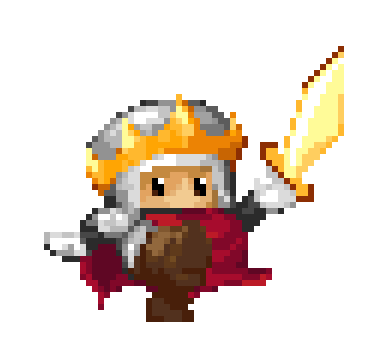
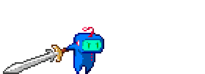

import LightingSample from '!!raw-loader!./samples/lighting.ts';
import ShaderEffectsSample from '!!raw-loader!./samples/shader-effects.ts';
import GlslPipelineSample from '!!raw-loader!./samples/glsl-pipeline.ts';
import SoundMixerSample from '!!raw-loader!./samples/sound-mixer.ts';
import PauseSample from '!!raw-loader!./samples/pause.ts';
import PluginSample from '!!raw-loader!./samples/plugin.ts';
import SdfTextSample from '!!raw-loader!./samples/sdf-text.ts';
import WaterSample from '!!raw-loader!./samples/water.ts';
import ColorLerpSample from '!!raw-loader!./samples/color-lerp.ts';
import MusicLayersSample from '!!raw-loader!./samples/music-layers.ts';
import SpatialAudioSample from '!!raw-loader!./samples/spatial-audio.ts';
import SaveGameSample from '!!raw-loader!./samples/save-game.ts';
import AutoSaveSample from '!!raw-loader!./samples/auto-save.ts';
import PhysicsPyramidSample from '!!raw-loader!./samples/physics-pyramid.ts';
import AStarSample from '!!raw-loader!./samples/astar.ts';
import NineSliceSample from '!!raw-loader!./samples/nine-slice.ts';
import PixelArtSample from '!!raw-loader!./samples/pixel-art.ts';
import GpuParticlesSample from '!!raw-loader!./samples/gpu-particles.ts';


It's finally happening! Excalibur.js has been a labor of love for thirteen years! And we are finally here at v1!

```sh
npm install excalibur@1.0.0
```



## What does v1 mean?

Not much, it's basically been v1 for a while. Excalibur has been relatively stable with low bug reports, all our internal goals have been met, 
AND people are making commercial games on Steam and Itch.io.

Starting with v1, we'll be following semantic versioning as best we can and breaks are considered bugs and will be patched or feature flagged. 
As a result v1 does have some breaks (but it's mostly just api names) that have been batched up for a while, but we have [codemods](https://github.com/excaliburjs/create-excalibur/) to make this painless.

### On Steam

Speaking of Steam... here are some Excalibur games you should check out. If your Steam (or other platform) game runs on Excalibur and is not here, tell me!

- **[Now THAT'S a Big Dragon!](https://store.steampowered.com/app/3834590/Now_THATS_a_Big_Dragon/)** by Cotovelo Games, released August 2026. An idle game where you recruit an ever-growing army of heroes, stack upgrades, and watch the numbers go up as they chip away at a colossal dragon.
- **[A Nibble Tale](https://store.steampowered.com/app/4823670/A_Nibble_Tale/)** by Maxouhell Studios, in Early Access since August 2026. A pixel-art top-down action roguelite: the rats stole your little brother's snack, and Pinpin the rabbit is going to get it back.
- **[Estelle Igni: To Light Fires in the Night Sky](https://store.steampowered.com/app/4387830/Estelle_Igni_To_Light_Fires_in_the_Night_Sky/)** by Claire Scott, coming soon, wishlist it now. A JRPG of eternal night, blending techniques from thirteen classes to uncover the rifts consuming the stars.

### On Itch and the Web

- [SteamSpin](https://mookie4242.itch.io/steamspin)
- [PixelWar](https://jeanomeg.github.io/pixelwar/)
- [World Gen](https://papgar.itch.io/world-generation) and [Baby Bots](https://papgar.itch.io/baby-bots)
- [Some Deity Simulator](https://denetor.itch.io/some-deity-simulator-game) and [SeaDV](https://denetor.itch.io/seadv)
- [Asteroids](https://jibestudio.itch.io/asteroids)
- [Ten of You](https://moonnight-smithy.itch.io/ten-of-you)
- [Tanium Game Jam 2025](https://parnic.github.io/tanium-game-jam-2025/)

## New to Excalibur?

Excalibur is the friendly 2D TypeScript game engine for the web, no dependencies, free and open source BSD-2 forever.

Support for popular tools:
* [Tiled](/docs/tiled-plugin)
* [LDtk](/docs/ldtk-plugin)
* [SpriteFusion](/docs/spritefusion-plugin)
* [Aseprite](/docs/aseprite-plugin)
* [JSFXR](https://github.com/excaliburjs/excalibur-jsfxr) 

## Sweet New Features in v1

- Performance Improvements
- 2D Lighting
- Pause System
- Material/Postprocessor Shader Pipelines
- Serialization API
- Sound Manager API
- Sound Mixing API
  - Layering/Spatial audio
- Excalibur CLI Tool

{/* truncate */}

## Performance Improvements

A lot of the improvements have been made by removing object allocation from the hot loop, pooling frequently used objects, scratch objects,
and clever data structures.

We especially spent time in the collision system to improve performance drastically since v0.32.0

TODO ERIK IS TIRED, HE WILL PUT CHART HERE. TRUST ME IT'S BETTER.

So we don't lose sight of our hard won gains, we now have a [excalibur-benchmark](https://github.com/excaliburjs/excalibur-benchmark) that runs on PRs

## 2D Lighting

This was the most requested feature by far. Justin spent a lot of time prototyping (and re-prototyping) different lighting concepts until we settled on the one we liked. He deserves most of the credit for this feature.

We have ambient lights, point lights, cone lights, and occluders!

```typescript
const game = new ex.Engine({
  lighting: {
    enabled: true,
    ambientIntensity: 0.08,
    ambientColor: ex.Color.fromRGB(70, 70, 160) // moonlit blue
  }
});

// Darkness covers the screen (or a rectangular "room" with width/height)
const night = new ex.Actor();
night.addComponent(new ex.DarknessComponent({ color: ex.Color.fromRGB(0, 0, 12), intensity: 0.92 }));

// Point lights can flicker
const torch = new ex.Actor({ pos: ex.vec(90, 70) });
torch.addComponent(
  new ex.PointLightComponent({
    color: ex.Color.fromRGB(255, 170, 60),
    radius: 160,
    flicker: { frequency: 3, amplitude: 0.2 }
  })
);

// Cone lights are flashlights, aim them with `direction`
const flashlight = new ex.ConeLightComponent({ radius: 320, angle: Math.PI / 5, softness: 0.35 });

// Anything with an occluder casts a shadow
crate.addComponent(new ex.LightOccluderComponent({ shape: { kind: 'box', width: 48, height: 48 } }));
```

Move the mouse to aim the knight's lantern, click to drop more lights. The stones are occluders, the slimes are occluders and green lights 
at the same time, and a spider is hiding in the dark:

<PlaygroundEmbed title="2D Lighting" code={LightingSample} mount="visible" />

Lighting is opt-in because the overlay is rasterized with the 2D Canvas API and re-uploaded to the GPU every frame, which has a cost. Pass a `LightingConfig` object to tune the ambient floor, shadow opacity, culling padding, and more, or add a `LightingSystem` to just the scenes that need it.

## Pause System

Ever want to pause a game? Well now you can without stopping the game loop that drives your UI/UX. Add or configure `ex.PauseComponent`s on your
entities or actors.

Scenes can `pause()` and `resume()`. Every `Actor` carries a `PauseComponent` by default, `canPause: false` opts an entity out so menus, 
HUDs, and pause screens keep running (a `ScreenElement` defaults to `canPause: false`). Read `actor.isPaused` anywhere you need to branch. 
Read more in the [pause docs](/docs/pause).

<PlaygroundEmbed title="Pause" code={PauseSample} mount="visible" />

## Material/Postprocessor Shader Pipelines

Before v1 you could only have 1 shader on your Actor materials or on the Screen postprocessors. Now you can compose shaders together in sequence making
it much easier to achieve composable and re-usable effects. This enables a cheap way to implement Blur, Glow, and Bloom effects by upsampling
and downsampling in between shader passes.


```typescript
const graphicsContext = game.graphicsContext;

// Per graphic: `padding` gives the halo room outside the sprite's quad
const glow = new ex.GlowEffect({ graphicsContext, color: ex.Color.Cyan, strength: 3 });
actor.graphics.material = new ex.Material({ graphicsContext, passes: glow, padding: 24 });

// Fullscreen
game.graphicsContext.addPostProcessor(
  new ex.ShaderPipelinePostProcessor({
    passes: new ex.BloomEffect({ graphicsContext, threshold: 0.5, intensity: 1.2 })
  })
);

// Settings are live
glow.intensity = 0.5;
```

Click to toggle the fullscreen bloom:

<PlaygroundEmbed title="Blur, Glow, and Bloom" code={ShaderEffectsSample} mount="visible" />

Under the hood these are built on new public primitives: `ex.Framebuffer` (a render destination that is also a texture source), `ex.ShaderPass` (one fragment shader applied to an image), and `ex.ShaderPipeline` (a linear chain with per-pass scaling). Anything implementing `process(source, destination)` can be a pipeline, so custom non-linear graphs are fair game. The pass factories `createBlurPasses` and `createGlowPasses` are exported for splicing into your own chains.

### The `glsl` tag and writing your own pipelines

One foot-gun we've heard about is Excalibur's rendering is [premultiplied-alpha](https://www.realtimerendering.com/blog/gpus-prefer-premultiplication/). The new `ex.glsl` tagged template literal fixes that by
detecting if your fragment is authored in a straight-alpha space and updating it accordingly. The tag also adds the annoying glsl `#version 300 es`
and `precision mediump float` boilerplate.

Pass a list of fragments as `passes` and they run in order. Add a `fragmentSource` too and it becomes the final composite, with the pipeline output bound as `u_graphic` and the untouched graphic as `u_original`. Uniforms are now a plain dictionary on the material that reaches every pass:

```typescript
const material = new ex.Material({
  graphicsContext,
  passes: [wobble, dissolve],
  fragmentSource: composite,
  uniforms: { u_amount: 0.01, u_dissolve: 0.0 }
});

// no shader binding, no trySetUniform*, just assign
material.uniforms.u_dissolve = 0.5;
```

Move the mouse left and right to dissolve the sword, up and down to wobble it:

<PlaygroundEmbed title="glsl tag pipeline" code={GlslPipelineSample} mount="visible" />

`Material.update()` now hands your callback a `MaterialContext` with `uniforms`, `shaders`, and `shadersByName` instead of a single composite 
shader. Materials are also enumerable through `game.graphicsContext.materials`, each with an `id` and readable sources, so tooling like the 
[browser dev tools extension](https://github.com/excaliburjs/excalibur-extension) can inspect them.

## Serialization API

We can now serialize built in excalibur types (and developer provided ones) to JSON and back. This is great for communicating over the wire for multiplayer 
server situations and for saving games to disk (or browser localstorage).

```typescript
ex.Serializer.init(); // registers the built-in components
ex.Serializer.registerGraphics({ gem: gemGraphic, hero: heroGraphic });
ex.Serializer.registerComponent(LootComponent);
ex.Serializer.registerCustomActors([Gem, Hero]);

// save: everything tagged 'saveable' becomes JSON
const actors = scene.actors.filter((a) => a.hasTag('saveable'));
localStorage.setItem('save', JSON.stringify(actors.map((a) => ex.Serializer.serializeActor(a))));

// load: actors come back as Gem and Hero instances with their components restored
for (const data of JSON.parse(localStorage.getItem('save')!)) {
  scene.add(ex.Serializer.deserializeActor(data)!);
}
```

<PlaygroundEmbed title="Save games" code={SaveGameSample} mount="visible" />

## Plugin API

Inspired by the Bevy plugin system, we now have a one stop abstraction to deeply configure the internals of the engine. In particular you may be interested
in installing an ECS system, custom renderer, pre/post lifecycle hooks all with one type! 

```typescript
const engine = new ex.Engine({
  plugins: [new MyCoolPlugin()]
});
```

### Auto Save Plugin

The Serializer and the plugin hooks compose. A scene's lifecycle already marks the right moments to snapshot and restore, so an auto-save plugin is short: save every tagged actor on a timer, in `onScenePreDeactivate`, and on `pagehide`, then put them back in `onScenePostActivate`. The game only registers its classes and decides what carries the tag.

```typescript
class AutoSavePlugin extends ex.Plugin {
  override onScenePostInitialize(scene: ex.Scene) {
    const timer = new ex.Timer({ interval: 2000, repeats: true, action: () => this.save(scene) });
    scene.add(timer);
    timer.start();
  }
  override onScenePreDeactivate(scene: ex.Scene) {
    this.save(scene);
  }
  override onScenePostActivate(scene: ex.Scene) {
    this.restore(scene);
  }

  save(scene: ex.Scene) {
    const actors = scene.actors.filter((actor) => actor.hasTag('saveable'));
    localStorage.setItem(this.key(scene), JSON.stringify(actors.map((actor) => ex.Serializer.serializeActor(actor))));
  }

  restore(scene: ex.Scene) {
    const json = localStorage.getItem(this.key(scene));
    if (json) {
      scene.actors.filter((actor) => actor.hasTag('saveable')).forEach((actor) => scene.world.remove(actor, false));
      for (const data of JSON.parse(json)) {
        scene.add(ex.Serializer.deserializeActor(data));
      }
    }
  }
}
```

Collect some gems, take the chest down to the mine, then hit reload. The hero, the score, and which gems are gone all come back, per scene:

<PlaygroundEmbed title="Auto-save plugin" code={AutoSaveSample} mount="visible" />

Custom types get a `registerCustomSerializer(name, serialize, deserialize)` hook, and the output is validated with `validateEntityData` before it is trusted, so a corrupted save fails loudly instead of half-loading.

### Custom Renderer 

A renderer owns its vertex layout, so it is not limited to textured quads. This water renderer runs a row of springs (each column pulls back toward rest and hands its motion to its neighbors), then uploads two triangles per column with the depth and the surface speed as vertex attributes. The fragment shader turns those into the color gradient, the drifting caustics, and the foam on fast moving crests. Every body of water in the frame lands in the same vertex buffer and one `drawArrays` call. The plugin side is the same three pieces as the SDF text example: a `RendererPlugin`, a `Graphic` that calls `context.draw('water', ...)`, and a `Plugin` that registers it.

```typescript
class WaterRenderer implements ex.RendererPlugin {
  readonly type = 'water';

  initialize(gl: WebGL2RenderingContext, context: ex.ExcaliburGraphicsContextWebGL) {
    this._shader = new ex.Shader({ name: 'water', graphicsContext: context, vertexSource, fragmentSource });
    this._shader.compile();
    this._layout = new ex.VertexLayout({
      gl,
      shader: this._shader,
      vertexBuffer: new ex.VertexBuffer({ gl, size: 5 * 6 * MAX_COLUMNS, type: 'dynamic' }),
      attributes: [['a_position', 2], ['a_depth', 1], ['a_foam', 1], ['a_phase', 1]]
    });
  }

  draw(sim: WaterSim, pos: ex.Vector, width: number, height: number) {
    const transform = this._context.getTransform();
    // two triangles per spring column, positions run through the current transform
  }

  flush() {
    this._shader.use();
    this._layout.use(true, this._vertexCount * 5);
    this._shader.setUniformMatrix('u_matrix', this._context.ortho);
    this._gl.drawArrays(this._gl.TRIANGLES, 0, this._vertexCount);
    this._vertexCount = 0;
  }
}
```

Click above the water to drop gems in, drag along the surface to stir it:

<PlaygroundEmbed title="Water renderer plugin" code={WaterSample} mount="visible" />


## Sound Manager API

`SoundManager` was rebuilt as an actual mixer: `Sound.output → channel → master → speakers`. 
Volume and mute are gain nodes at each level instead of numbers multiplied into every `play()` call, which means muting no longer pauses, 
a muted sound keeps advancing and is mid-clip when you unmute, and `channel.setVolume()` finally does something.

Every bus exposes its Web Audio nodes, so filters, compressors, reverb, analysers, and spatial panning are a few lines each:

```typescript
const mixer = new ex.SoundManager({
  channels: [
    { name: 'fx', maxConcurrentTracks: 4, voiceStealing: true },
    {
      name: 'music',
      volume: 0.5,
      // channel bus effects: everything on this channel runs through the filter
      onConnect: ({ input, output }) => input.connect(lowpass).connect(output)
    }
  ],
  sounds: [
    { name: 'dig', sound: dig, channel: 'fx', volume: 0.6 },
    { name: 'music', sound: title, channel: 'music' }
  ],
  // master bus effects
  onConnect: ({ audioContext, input, output }) => {
    input.connect(audioContext.createDynamicsCompressor()).connect(output);
  }
});

// per-play overrides never change the Sound's configuration
mixer.play('dig', {
  pitch: -300, // cents
  onPlay: ({ audioContext, source, destination }) => {
    const panner = audioContext.createStereoPanner();
    panner.pan.value = -0.8;
    source.connect(panner).connect(destination);
  }
});

// effect nodes stay live, automate them and the mix changes in place
lowpass.frequency.setTargetAtTime(400, audioContext.currentTime, 0.1);

// channels expose their nodes too, if you would rather rewire by hand
const music = mixer.getChannel('music');
music.input.disconnect();
music.input.connect(reverb).connect(music.output);
```

Also new: `Sound.pitch`, `Sound.start()` which returns the `SoundTrack` synchronously so you can stop or seek one playback, `maxConcurrentTracks` caps with `voiceStealing`, `Sound.fromBlob()`, and the `SoundManager` is `Loadable` so one `loader.addResource(mixer)` loads everything it manages.

Turn your volume up and dig around (digs pan to where you click and no two have the same pitch, some tiles hide gems), then try the music buttons. The mixer is one `Loadable`, so the `Loader` fetches every sound it manages:

Music by [Tim Peterson](https://timpeterson.me/)

<PlaygroundEmbed title="Sound mixer" code={SoundMixerSample} mount="visible" />

## Spatial Audio

Because `onPlay` hands you the raw Web Audio graph, positional sound is the same hook with a `PannerNode` instead of a stereo panner. The context also includes the `SoundTrack` being started, which is the natural key for remembering per-playback effect nodes, so a moving emitter can keep updating its panner every frame. `Sound.start()` (and `SoundManager.start()`) return that track synchronously, and the `AudioContext` listener follows the player:

```typescript
const panners = new WeakMap<ex.SoundTrack, PannerNode>();
const spatialize =
  (pos: ex.Vector): ex.AudioGraphBuilder =>
  ({ audioContext, source, destination, track }) => {
    const panner = new PannerNode(audioContext, {
      panningModel: 'HRTF',
      distanceModel: 'inverse',
      refDistance: 60, // pixels
      positionX: pos.x,
      positionZ: pos.y
    });
    source.connect(panner).connect(destination);
    panners.set(track, panner);
  };

// a looping emitter, moved every frame
const scurry = mixer.start('scurry', { onPlay: spatialize(beetle.pos) });
beetle.onPostUpdate = () => {
  const panner = panners.get(scurry!)!;
  panner.positionX.setTargetAtTime(beetle.pos.x, audioContext.currentTime, 0.05);
  panner.positionZ.setTargetAtTime(beetle.pos.y, audioContext.currentTime, 0.05);
};

// one-shots are positioned the same way
mixer.play('bite', { onPlay: spatialize(beetle.pos) });

// the player is the listener
audioContext.listener.positionX.setTargetAtTime(player.pos.x, audioContext.currentTime, 0.05);
audioContext.listener.positionZ.setTargetAtTime(player.pos.y, audioContext.currentTime, 0.05);
```

Put on headphones, then click or use WASD to walk. The beetle scurries past from one ear to the other and bites when it catches you, and the music box in the corner swells as you get close:

Music by [Tim Peterson](https://timpeterson.me/)

<PlaygroundEmbed title="Spatial audio" code={SpatialAudioSample} mount="visible" />

## Layered Audio

The mixer also makes layered, adaptive music simple. Give every stem the same `scheduledStartTime` on the audio clock and they start sample-aligned and stay in phase, then crossfade them with `setVolume` as the game state changes. This is exactly how [Gem Jam](https://excaliburjs.com/ludum-58/), our Ludum Dare 58 entry, brings in the drums and the topper as you dig deeper, and the sample below uses its stems. Move the mouse down to dig:

```typescript
const start = ex.AudioContextFactory.currentTime() + 200; // milliseconds on the audio clock
mixer.play('surface', { scheduledStartTime: start });
mixer.play('drums', { scheduledStartTime: start });
mixer.play('topper', { scheduledStartTime: start });

// later, per frame: the sound's mix gain, Sound.volume is untouched
mixer.setVolume('drums', depth);
```

Music by [Tim Peterson](https://timpeterson.me/)

<PlaygroundEmbed title="Adaptive music layers" code={MusicLayersSample} mount="visible" />

## Excalibur CLI `ex`

[create-excalibur](https://github.com/excaliburjs/create-excalibur) grew up. It still scaffolds a game in your preferred frontend stack, and now it also:

```sh
npx create-excalibur@latest            # scaffold a game
npx create-excalibur@latest upgrade    # migrate to a newer Excalibur, codemod-style
npx create-excalibur@latest doctor     # type-aware diagnostics for common mistakes
npx create-excalibur@latest generate   # generate an actor, scene, material, spritesheet, ...
npx create-excalibur@latest docs       # search the docs from your terminal, offline too
npx create-excalibur@latest mcp        # MCP server so AI agents use the real docs and codemods
```

If you install it globally you have access to the `ex` command for short ([yes, I did overload the oldschool text editor command...](https://en.wikipedia.org/wiki/Ex_(text_editor)))

```sh
ex upgrade    # migrate to a newer Excalibur, codemod-style
ex doctor     # type-aware diagnostics for common mistakes
ex generate   # generate an actor, scene, material, spritesheet, ...
ex docs       # search the docs from your terminal, offline too
ex mcp        # MCP server so AI agents use the real docs and codemods
```

## ICYMI

#### A\* pathfinding

The core `ex.Graph` now gives you A\*, Dijkstra, breadth first and depth first search, no plugin required. Build a graph by hand, or straight from the cells of a `TileMap` like below: one `PositionNode` per walkable tile, an edge to each walkable neighbor, then call `graph.aStar(start, end)`. Click a tile and the knight finds its way around the stone and the spiders, click a stone tile to clear it or a spider to squash it and watch the route change. The graph is rebuilt and searched from scratch on every click, and the status label reports how long that took. The art and sound effects are from the [sample tactics game](https://excaliburjs.com/sample-tactics/).

Art authored by discord member HintOfLime!

<PlaygroundEmbed title="A* pathfinding" code={AStarSample} mount="visible" />

#### Nine-slice

`ex.NineSlice` takes a small source image and grows it to any size while keeping the corners and edges crisp. Each axis can stretch, tile, or tile-fit the middle region independently, which covers dialog boxes, buttons, health bars and textured platforms with one tiny asset. The source here is the 20x15 brick tile from the sample platformer, so the three modes are easy to tell apart: stretch smears the bricks, tile repeats them, and tile-fit squeezes in whole bricks.

<PlaygroundEmbed title="NineSlice" code={NineSliceSample} mount="visible" />

#### Pixel art mode

Pixel art is deceptively hard to render well. Plain nearest-neighbor sampling shimmers when sprites move at fractional speeds and grows fat and thin pixels when they rotate, while plain bilinear filtering turns everything blurry. `new ex.Engine({ pixelArt: true })` enables a special pixel art sampler in the shader that snaps to texel edges but antialiases the boundary between them, keeps the texture filtering and canvas settings that make it work.

Read more here, we use the Inigo Quilez version of the [pixel art filter](https://jorenjoestar.github.io/post/pixel_art_filtering/)

<PlaygroundEmbed title="Pixel art mode" code={PixelArtSample} mount="visible" />

#### GPU particles

`ex.GpuParticleEmitter` has the same configuration as the CPU `ParticleEmitter` but simulates and draws the particles on the GPU. Tens of thousands of particles cost roughly the same as a few hundred, so rain, sparks, dust and spell effects stop being a performance burden. Good looking fire is really four cheap emitters stacked up.

<PlaygroundEmbed title="GPU particles" code={GpuParticlesSample} mount="visible" />

### And more

- **Coroutines.** `ex.coroutine(engine, function* () { ... })` runs a generator on the engine clock. A bare `yield` waits a frame and hands you the elapsed time, `yield 500` waits 500 milliseconds, and yielding a promise awaits it. They are a wonderful way to write cutscenes, boss patterns and multi-step animations as straight-line code.
- **Scene transitions and per-scene loaders.** Scenes can declare their own resources and `in`/`out` transitions, or you can pass them at the call site: `engine.goToScene('level2', { destinationIn: new ex.Slide({ duration: 500, slideDirection: 'left' }) })`. `FadeInOut`, `CrossFade` and `Slide` ship in the box, and `Transition` is easy to extend.
- **Bezier curves.** `ex.BezierCurve` for sampling cubic curves, and `actor.actions.curveTo({ controlPoints: [c1, c2, end], duration })` and `curveBy` to move along them.
- **Input mapping.** `engine.inputMapper.on(({ keyboard, gamepads }) => ..., command)` maps any combination of keyboard, gamepad and pointer state onto game commands, which is also the foundation for remappable controls and accessibility options.
- **Materials.** Per-actor fragment shaders with `new ex.Material({ fragmentSource })`, with extra images and uniforms. v1's `glsl` tag and shader pipelines build on this.
- **Tiling sprites.** `ex.TiledSprite` and `ex.TiledAnimation` repeat a sprite across a region at the GPU's expense instead of yours, and `SpriteSheet.getTiledSprite` pulls one out of a sheet.
- **Fixed update.** `new ex.Engine({ fixedUpdateFps: 60 })` decouples simulation from the display refresh rate so physics behaves the same on a 60 Hz laptop and a 240 Hz monitor. The pyramid above relies on it.
- **Debug drawing anywhere.** `ex.Debug.drawLine`, `drawCircle`, `drawText` and friends work from any code path, no graphics context required, and `engine.toggleDebug()` flips the whole debug overlay.
- **Typed events.** `ex.EventEmitter<TEventMap>` gives every `events.on(...)` call autocompletion and checked payloads, and `ex.StateMachine` is a tiny typed finite state machine for AI and UI flows.

## Migrating to v1

We are hoping to make migrating v0.x games easy, with the `npx create-excalibur@latest upgrade` command

## Future Plans

- WebGPU + HTML-in-Canvas
- Excalibur Editor (think Unity/Godot but for Excalibur)
- Console porting
- Inaugural Excalibur Game Jam! (SOOOON)
- Commercial games from us at [Caliburn Games](https://caliburn.games/products/)

## Thank you

Excalibur started in January 2013 as a side project between friends, and it got to v1 because people kept showing up. Every one of these folks landed a commit in the core engine over the last thirteen years:

<div className="gh-avatars">
  <a href="https://github.com/eonarheim" title="eonarheim">
    
  </a>
  <a href="https://github.com/kamranayub" title="kamranayub">
    
  </a>
  <a href="https://github.com/jedeen" title="jedeen">
    
  </a>
  <a href="https://github.com/jyoung4242" title="jyoung4242">
    
  </a>
  <a href="https://github.com/mattjennings" title="mattjennings">
    
  </a>
  <a href="https://github.com/chrisk-7777" title="chrisk-7777">
    
  </a>
  <a href="https://github.com/alanag13" title="alanag13">
    
  </a>
  <a href="https://github.com/Autsider666" title="Autsider666">
    
  </a>
  <a href="https://github.com/hogart" title="hogart">
    
  </a>
  <a href="https://github.com/catrielmuller" title="catrielmuller">
    
  </a>
  <a href="https://github.com/djcsdy" title="djcsdy">
    
  </a>
  <a href="https://github.com/LoserAntbear" title="LoserAntbear">
    
  </a>
  <a href="https://github.com/isokissa" title="isokissa">
    
  </a>
  <a href="https://github.com/muhajirdev" title="muhajirdev">
    
  </a>
  <a href="https://github.com/mosesintech" title="mosesintech">
    
  </a>
  <a href="https://github.com/jasonlh-harris" title="jasonlh-harris">
    
  </a>
  <a href="https://github.com/Crizzooo" title="Crizzooo">
    
  </a>
  <a href="https://github.com/andrewmbyrd" title="andrewmbyrd">
    
  </a>
  <a href="https://github.com/Sebring" title="Sebring">
    
  </a>
  <a href="https://github.com/mrkmg" title="mrkmg">
    
  </a>
  <a href="https://github.com/PurityLake" title="PurityLake">
    
  </a>
  <a href="https://github.com/T00mm" title="T00mm">
    
  </a>
  <a href="https://github.com/mathieuher" title="mathieuher">
    
  </a>
  <a href="https://github.com/rougepied" title="rougepied">
    
  </a>
  <a href="https://github.com/keasy9" title="keasy9">
    
  </a>
  <a href="https://github.com/edualb" title="edualb">
    
  </a>
  <a href="https://github.com/butlersrepos" title="butlersrepos">
    
  </a>
  <a href="https://github.com/Xstoudi" title="Xstoudi">
    
  </a>
  <a href="https://github.com/DaVince" title="DaVince">
    
  </a>
  <a href="https://github.com/thplat" title="thplat">
    
  </a>
  <a href="https://github.com/JumpLink" title="JumpLink">
    
  </a>
  <a href="https://github.com/Nimgoble" title="Nimgoble">
    
  </a>
  <a href="https://github.com/miqh" title="miqh">
    
  </a>
  <a href="https://github.com/SanjoSolutions" title="SanjoSolutions">
    
  </a>
  <a href="https://github.com/htalat" title="htalat">
    
  </a>
  <a href="https://github.com/guahanweb" title="guahanweb">
    
  </a>
  <a href="https://github.com/Carghaez" title="Carghaez">
    
  </a>
  <a href="https://github.com/DavidLi119" title="DavidLi119">
    
  </a>
  <a href="https://github.com/nidble" title="nidble">
    
  </a>
  <a href="https://github.com/Adamduehansen" title="Adamduehansen">
    
  </a>
  <a href="https://github.com/premsreelathasugeendran" title="premsreelathasugeendran">
    
  </a>
  <a href="https://github.com/robbertstevens" title="robbertstevens">
    
  </a>
  <a href="https://github.com/rubenmarcus" title="rubenmarcus">
    
  </a>
  <a href="https://github.com/rledford" title="rledford">
    
  </a>
  <a href="https://github.com/sweenist" title="sweenist">
    
  </a>
  <a href="https://github.com/saahilk" title="saahilk">
    
  </a>
  <a href="https://github.com/electro75" title="electro75">
    
  </a>
  <a href="https://github.com/SamuelAsherRivello" title="SamuelAsherRivello">
    
  </a>
  <a href="https://github.com/scottwestover" title="scottwestover">
    
  </a>
  <a href="https://github.com/pikooh" title="pikooh">
    
  </a>
  <a href="https://github.com/SirPedr" title="SirPedr">
    
  </a>
  <a href="https://github.com/pathurs" title="pathurs">
    
  </a>
  <a href="https://github.com/Nysosis" title="Nysosis">
    
  </a>
  <a href="https://github.com/jpninanjohn" title="jpninanjohn">
    
  </a>
  <a href="https://github.com/npretto" title="npretto">
    
  </a>
  <a href="https://github.com/MrBartusek" title="MrBartusek">
    
  </a>
  <a href="https://github.com/MohammadYusif" title="MohammadYusif">
    
  </a>
  <a href="https://github.com/mseyne" title="mseyne">
    
  </a>
  <a href="https://github.com/snowyukitty" title="snowyukitty">
    
  </a>
  <a href="https://github.com/sellmark" title="sellmark">
    
  </a>
  <a href="https://github.com/jellewijma" title="jellewijma">
    
  </a>
  <a href="https://github.com/jamesmcgeorge" title="jamesmcgeorge">
    
  </a>
  <a href="https://github.com/rjpgt" title="rjpgt">
    
  </a>
  <a href="https://github.com/ikudrickiy" title="ikudrickiy">
    
  </a>
  <a href="https://github.com/helloausrine" title="helloausrine">
    
  </a>
  <a href="https://github.com/egodjuks" title="egodjuks">
    
  </a>
  <a href="https://github.com/denetor" title="denetor">
    
  </a>
  <a href="https://github.com/aruru-weed" title="aruru-weed">
    
  </a>
  <a href="https://github.com/ZuzuZain" title="ZuzuZain">
    
  </a>
  <a href="https://github.com/vritant24" title="vritant24">
    
  </a>
  <a href="https://github.com/tonivj5" title="tonivj5">
    
  </a>
  <a href="https://github.com/kala2" title="kala2">
    
  </a>
  <a href="https://github.com/TheEyeOfBrows" title="TheEyeOfBrows">
    
  </a>
  <a href="https://github.com/sylfel" title="sylfel">
    
  </a>
  <a href="https://github.com/SurajGoel" title="SurajGoel">
    
  </a>
  <a href="https://github.com/SulthanNK" title="SulthanNK">
    
  </a>
  <a href="https://github.com/Guzzler" title="Guzzler">
    
  </a>
  <a href="https://github.com/malitherl" title="malitherl">
    
  </a>
  <a href="https://github.com/DavDag" title="DavDag">
    
  </a>
  <a href="https://github.com/davidagredano" title="davidagredano">
    
  </a>
  <a href="https://github.com/KakkoiDev" title="KakkoiDev">
    
  </a>
  <a href="https://github.com/cybrown" title="cybrown">
    
  </a>
  <a href="https://github.com/cosmicarrow" title="cosmicarrow">
    
  </a>
  <a href="https://github.com/cdelstad" title="cdelstad">
    
  </a>
  <a href="https://github.com/chrispanag" title="chrispanag">
    
  </a>
  <a href="https://github.com/chrisalley" title="chrisalley">
    
  </a>
  <a href="https://github.com/clofresh" title="clofresh">
    
  </a>
  <a href="https://github.com/ignoreintuition" title="ignoreintuition">
    
  </a>
  <a href="https://github.com/blakearoberts" title="blakearoberts">
    
  </a>
  <a href="https://github.com/nascob" title="nascob">
    
  </a>
  <a href="https://github.com/AphonicChaos" title="AphonicChaos">
    
  </a>
  <a href="https://github.com/agrgic16" title="agrgic16">
    
  </a>
  <a href="https://github.com/Thraka" title="Thraka">
    
  </a>
  <a href="https://github.com/BaconSoap" title="BaconSoap">
    
  </a>
  <a href="https://github.com/radist2s" title="radist2s">
    
  </a>
  <a href="https://github.com/SirKitboard" title="SirKitboard">
    
  </a>
  <a href="https://github.com/EpocDotFr" title="EpocDotFr">
    
  </a>
  <a href="https://github.com/reissbaker" title="reissbaker">
    
  </a>
  <a href="https://github.com/mcavazotti" title="mcavazotti">
    
  </a>
  <a href="https://github.com/jurca" title="jurca">
    
  </a>
  <a href="https://github.com/MaanasArora" title="MaanasArora">
    
  </a>
  <a href="https://github.com/lucasroman" title="lucasroman">
    
  </a>
  <a href="https://github.com/JustLeif" title="JustLeif">
    
  </a>
  <a href="https://github.com/kfalicov" title="kfalicov">
    
  </a>
  <a href="https://github.com/Joshua-Beatty" title="Joshua-Beatty">
    
  </a>
  <a href="https://github.com/Jerry457" title="Jerry457">
    
  </a>
  <a href="https://github.com/JeTmAn1981" title="JeTmAn1981">
    
  </a>
  <a href="https://github.com/Clemix37" title="Clemix37">
    
  </a>
  <a href="https://github.com/gsilis" title="gsilis">
    
  </a>
  <a href="https://github.com/gavriguy" title="gavriguy">
    
  </a>
  <a href="https://github.com/gargrave" title="gargrave">
    
  </a>
  <a href="https://github.com/eugenemed" title="eugenemed">
    
  </a>
  <a href="https://github.com/dylanavery720" title="dylanavery720">
    
  </a>
  <a href="https://github.com/Drknessfall" title="Drknessfall">
    
  </a>
</div>

Special thanks to the core team past and present: [Kamran Ayub](https://kamranicus.com/), [Jae Edeen](https://www.edeen.dev/), 
[Justin Young](https://mookie4242.itch.io/), [Matt Jennings](https://mattjennin.gs/), Cjadwick, [Chris K](https://github.com/chrisk-7777),
[Alan Grgic](https://github.com/alanag13) for the kind of sustained contributions that move an engine forward.

Additional thanks to HintOfLime for their fantastic art skills ♥️



WE HAVE EXCALIBUR!!!!!
