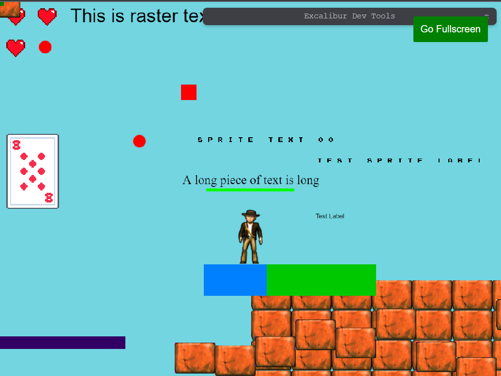
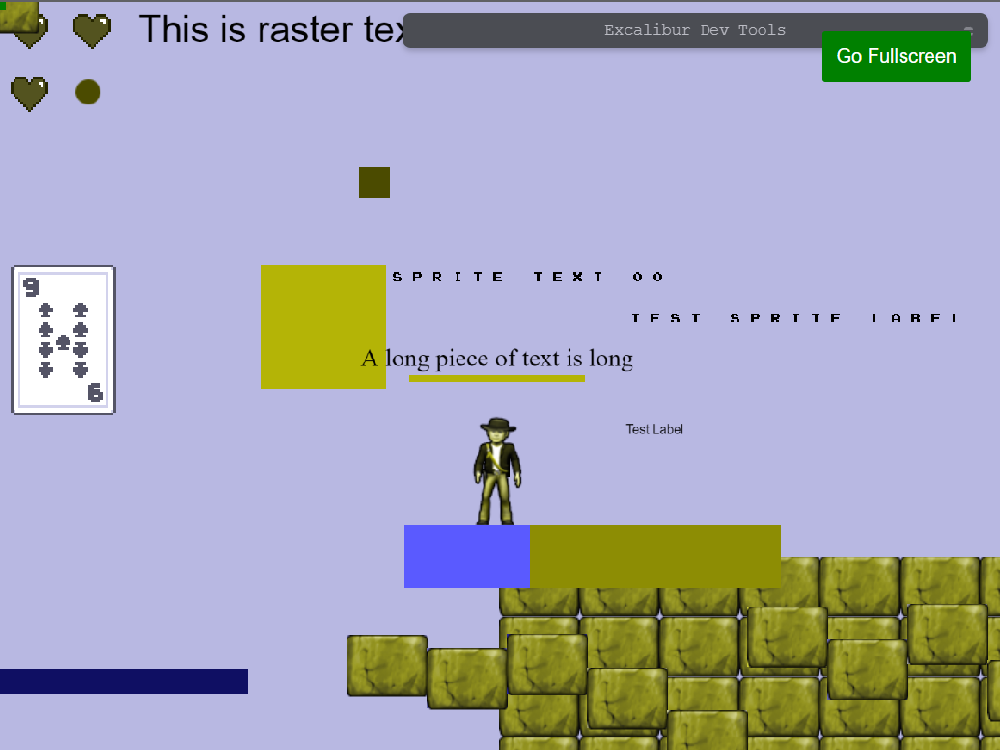
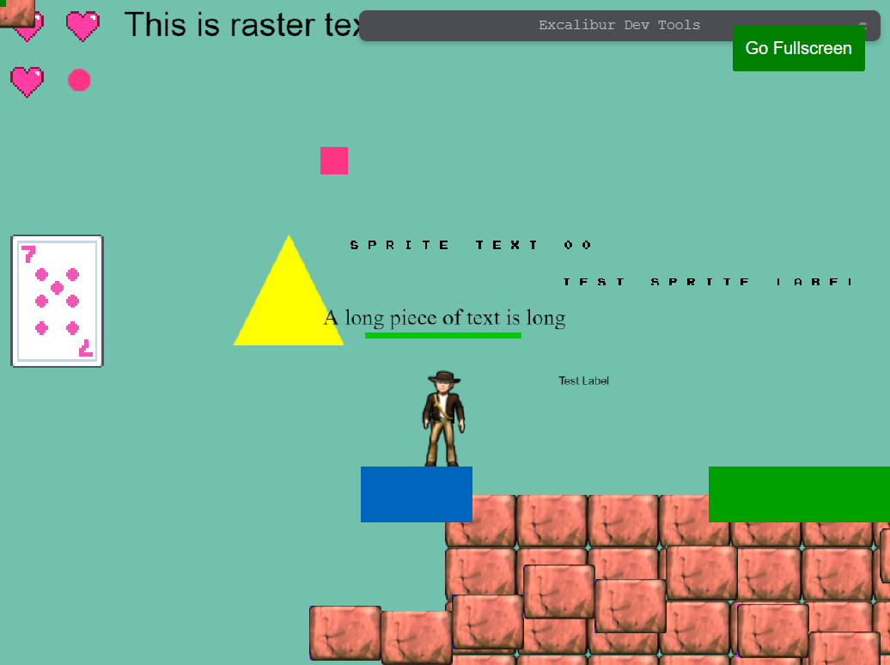
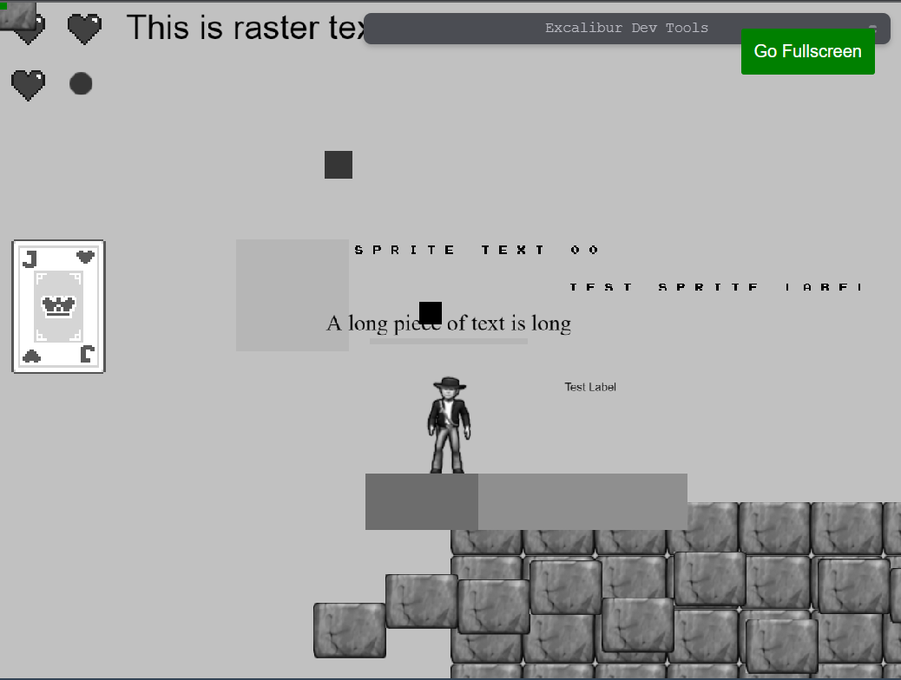

[[PostProcessor|PostProcessors]] are a way to quickly modify every pixel on the screen with WebGL fragment shaders. This can be useful to give your game a certain aesthetic or effect.

:::warning

PostProcessors are only supported in WebGL mode, this is the default mode for Excalibur but if you switch or fallback to 2D Canvas materials will not have an effect.

:::

If you want to do per actor shaders check out [Materials](/docs/materials)

## Color Blindness

Choosing colors that are friendly to players with color blindness is an important consideration when making a game.

There is a significant portion of the population that has some form of color blindness,
and choosing bad colors can make your game unplayable.

The three most common forms of [color blindness](https://en.wikipedia.org/wiki/Color_blindness) can be simulated or corrected. By default the [[ColorBlindnessPostProcessor]] corrects. The algorithm is originally sourced from http://www.daltonize.org/.

- [[ColorBlindnessMode.Protanope|Protanope]]
- [[ColorBlindnessMode.Deuteranope|Deuteranope]]
- [[ColorBlindnessMode.Tritanope|Tritanope]]

:::note

The color blindness correction is only an attempt to bump the colors into differentiable range. It is still best when designing to pick color blind friendly colors and to not use color to communicate information in your games without something else like a glyph. Remember, the best practice is to design with color blindness in mind.

:::

### Original

Here is the original game with no postprocessing applied.



### Simulation

```typescript
const game = new ex.Engine({...});

// simulate deuteranope
const colorblind = new ex.ColorBlindnessPostProcessor(ex.ColorBlindnessMode.Deuteranope, true);

game.graphicsContext.addPostProcessor(colorblind);

```



### Correction

```typescript
const game = new ex.Engine({...});

// correct deuteranope
const colorblind = new ex.ColorBlindnessPostProcessor(ex.ColorBlindnessMode.Deuteranope);

game.graphicsContext.addPostProcessor(colorblind);

```



## Custom Shader based Post Processors

Post processors can also be use to produce some interesting custom effects.

Implement `process(source, destination)` to render the screen (`source`) into `destination`, typically with a [[ShaderPass]]
or [[ShaderPipeline]]. [[ShaderPipelinePostProcessor]] is a shortcut that builds one from fragment sources. The only things that
come predefined are:

1.  `v_uv` representing the current UV from [0, 1]
2.  `u_image` which is the texture representing the screen pixels

In this example we can make the entire game gray scale:

```typescript
const grayscale = new ex.ShaderPipelinePostProcessor({
  name: 'grayscale',
  passes: [`#version 300 es
    precision mediump float;
    // our texture
    uniform sampler2D u_image;
    // the uvs passed in from the vertex shader.
    in vec2 v_uv;
    out vec4 fragColor;
    void main() {
      vec4 tex = texture(u_image, v_uv);
      float avg = 0.2126 * tex.r + 0.7152 * tex.g + 0.0722 * tex.b;
      fragColor = vec4(avg, avg, avg, 1.0);
    }`]
});
game.graphicsContext.addPostProcessor(grayscale);
```


